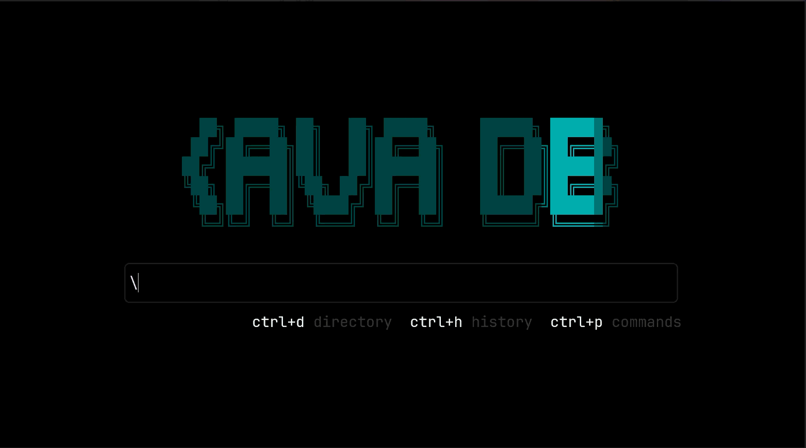

# Java-DB



> [!NOTE]
> The application was completed and pushed prior to the deadline. Further optional modifications were applied to the TUI interface. Hash of the last command before the deadline: `ebd52eb4494872b85699dc8b65cba090313febc1` (`Merge remote-tracking branch 'origin/fedorov' into fedorov`).

***

Simple in-memory DBMS made with pure Java. Features SQL-like commands and terminal UI inspired by [OpenCode](https://opencode.ai) and launched by the [TamboUI](https://tamboui.dev) framework.

## Valid requests:

- ```CREATE TABLE <table_name> (<column> <type> [PRIMARY KEY] [REFERENCES <ref_table>], ...);```
- ```DROP TABLE <table_name>;```
- ```INSERT INTO <table_name> VALUES (<val1>, <val2>, ...) [, (...)];```
- ```INSERT INTO <table_name> (<col1>, <col2>, ...) VALUES (<val1>, <val2>, ...) [, (...)];```
- ```SELECT * FROM <table_name> [WHERE <column> <operator> <value>];```
- ```SELECT <col1>, <col2>, ... FROM <table_name> [WHERE <column> <operator> <value>];```
- ```UPDATE <table_name> SET <col1> = <val1>, ... [WHERE <column> <operator> <value>];```
- ```DELETE FROM <table_name> [WHERE <column> <operator> <value>];```

Supported types: `INT` / `INTEGER`, `DOUBLE` / `FLOAT`, `STRING`, `DATE` (`'YYYY-MM-DD'`), `BOOLEAN` / `BOOL`

Supported operators: `=`, `!=`, `<`, `>`, `<=`, `>=`

`STRING` and `DATE` values must be enclosed in single quotes (`'...'`). Every query must end with `;`.

Safe Recovery: Guarantees no data corruption after unexpected crashes using atomic temporary saves.

## Building and running from source

Build the package with maven then run `Java-DB-1.0-SNAPSHOT.jar` in `./target` (`java -jar target/Java-DB-1.0-SNAPSHOT.jar` in terminal).

## TUI features:

### Keyboard Shortcuts

**General**
- `ctrl+p` open command palette
- `ctrl+l` clear screen
- `ctrl+q` save database and quit
- `\help` show cheat sheet

**Database & Demo**
- `ctrl+s` save database to disk
- `\dt` show tables
- `\demo` create demo sample database
- `\democlear` clear demo sample data

**Input & Navigation**
- `ctrl+enter` execute input
- `ctrl+h` open history (if there are successful commands)
- `PgUp` / `PgDn` scroll vertically
- `alt+←` / `alt+→` scroll horizontally

### Autocomplete
Our TUI features a smart "ghost text" autocomplete based on your command history:
- `→` accept the entire suggested query
- `ctrl+→` accept the suggestion word by word

### Syntax Highlighting
The input field and history support real-time syntax highlighting for:
- SQL Keywords (`SELECT`, `INSERT`, `UPDATE`, etc.)
- Data Types (`BOOLEAN`, `NUMBER`, `STRING`)
- Autocomplete Suggestions (rendered as dim ghost text)

## Credits

- [Федоров Вадим](https://github.com/Istj52) (Interactive TUI (`tui`) & File Storage (`storageService`))
- [Ахмедов Барат](https://github.com/baratahmedov43-collab) (SQL Parsing Engine & Request Handling (`requestHandler`))
- [Цаплин Сергей](https://github.com/derzelenevskiy) (Database Core (`db`))
